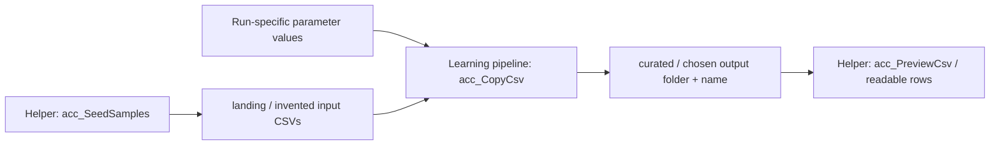
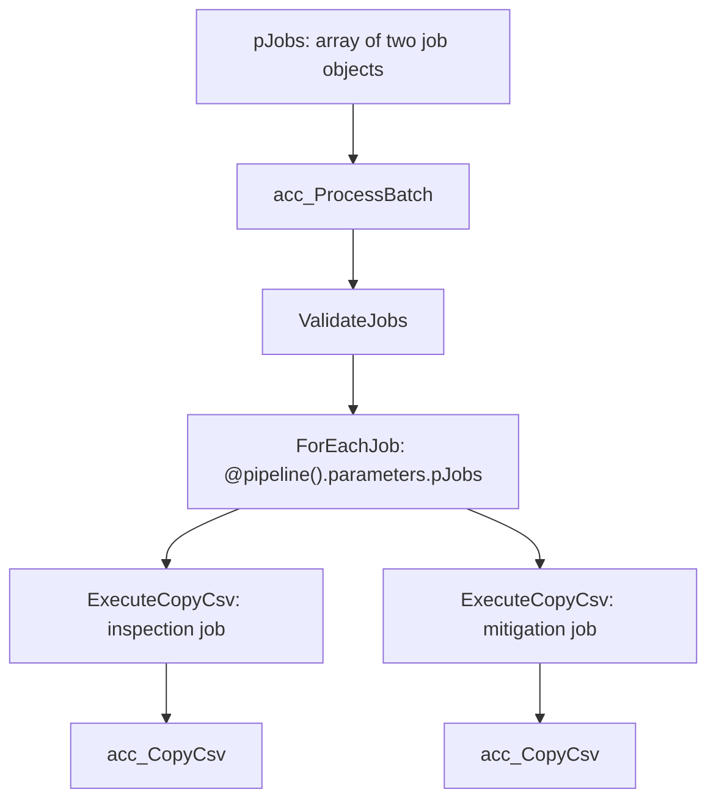

# Walkthrough: understand your deployed parameterized ADF sample

[Back to quick start](../README.md#quick-start)

**Audience:** someone who has just deployed the accelerator and wants to understand what happened, not just see a successful deployment.

**Learning outcome:** explain how one pipeline and one dataset can copy different files without editing or republishing either definition.

All records here are invented. This is a learning sample, not a production or regulatory reference architecture.

## 1. Orient yourself: what just happened?

The deployment did two different kinds of work:

1. **Provisioning:** Bicep created a factory, storage, containers, identity permissions, and ADF definitions.
2. **Execution:** the deployment script ran `acc_SeedSamples`, loading the two small CSVs from the repository into `landing`.

Deployment alone does **not** run the learning copy or batch pipeline. The quick start's `Run-Demo.ps1` command does that separately.



### Find your actual resource names

From the cloned repository folder:

```powershell
$deployment = Get-Content -Raw .\.local\deployment.json | ConvertFrom-Json
$deployment | Format-List
```

Names include a generated suffix so different resource groups can host independent samples. This local file is your deployment's address book, not a credential file. It is Git-ignored and must not be copied from somebody else's environment.

Open the printed `studioUrl`, or find the factory in Azure Portal and select its Studio/authoring experience.

### Inventory to recognize

| Deployed item | What it means | Where to inspect |
|---|---|---|
| `adf-...` factory | Orchestrates activities and owns the managed identity | Azure Portal and ADF Studio |
| `st...` StorageV2 account | Holds source and destination blobs | Azure Portal resource overview |
| `landing` container | Contains the two invented input CSVs | Storage container configuration; access may be network-blocked from your workstation |
| `curated` container | Receives output copies | Preview helper and ADF Monitor |
| `acc_BlobStorage` | Linked service: how ADF connects to the account | Studio **Manage > Linked services** |
| `acc_Csv` | Dataset: which CSV and how it is formatted | Studio **Author > Datasets > Accelerator** |
| `acc_CopyCsv` | Core reusable, single-file pipeline | Studio **Author > Pipelines > Accelerator** |
| `acc_ProcessBatch` | Optional parent that calls the core pipeline for each job | Same pipeline folder |
| `acc_SeedSamples` / `acc_PreviewCsv` | Setup and inspection helpers, not the core parameterization lesson | **Accelerator/Helpers** |
| Container-scoped role assignments | Let the factory identity read/write the appropriate containers | Azure Portal **Access control (IAM)** |

No SQL database, mapping-data-flow cluster, scheduled trigger, custom/self-hosted integration runtime, or private endpoint is created. Activities use the built-in Azure integration runtime.

## 2. Learn the four layers

Do not confuse parameters that provision resources with parameters that select data at runtime.

| Layer | Question it answers | Example in this sample |
|---|---|---|
| **Bicep deployment parameters** | What Azure resources should exist? | Region, name prefix, existing factory selection |
| **Linked service** | How do I connect to this data store? | Blob account endpoint plus factory managed identity |
| **Pipeline parameters** | What should this particular run do? | Source folder/file and destination folder/file |
| **Dataset parameters** | Which physical file should this activity read or write? | Container, folder, file name, delimiter |

The linked service is deployment-bound here. File paths and delimiter are run-bound. The sample does **not** dynamically select arbitrary accounts or connector types.

**Key distinction:** a parameter is a named input. An expression is the rule that obtains or combines values. Merely declaring a parameter does not make a hard-coded dataset dynamic; the activity and dataset must bind and use it.

## 3. Follow one value all the way to a blob

Open [copy.parameters.json](../examples/copy.parameters.json). The first run supplies:

```json
{
  "pSourceContainer": "landing",
  "pSourceFolder": "2026-01-15/demo-utility-a",
  "pSourceFile": "inspections.csv",
  "pSinkContainer": "curated",
  "pSinkFolder": "single-copy/2026-01-15/demo-utility-a",
  "pSinkFile": "renamed-inspections.csv",
  "pDelimiter": ","
}
```

Trace `pSinkFile`:

```text
Run input: pSinkFile = "renamed-inspections.csv"
  -> acc_CopyCsv pipeline parameter
  -> CopyCsv output dataset binding:
       pFile = @pipeline().parameters.pSinkFile
  -> acc_Csv dataset parameter pFile
  -> dataset location.fileName = @dataset().pFile
  -> physical blob name ends with renamed-inspections.csv
```

The container and folder follow the same path. Together, they identify:

```text
curated/single-copy/2026-01-15/demo-utility-a/renamed-inspections.csv
```

### Inspect it in Studio

1. Open `acc_CopyCsv` and its **Parameters** tab. Find all seven inputs.
2. Open `CopyOrFail`'s **True** branch, then select `CopyCsv`.
3. Inspect **Source** and **Sink** dataset parameter bindings. The same `acc_Csv` dataset is used twice with different values.
4. Open `acc_Csv`, then inspect its **Parameters** and **Connection** settings.
5. Find the dynamic expressions for container, folder, file, and delimiter.
6. Open `acc_BlobStorage` and confirm that it points to your newly deployed account and uses the factory's managed identity, not a storage key.

UI labels can vary by Studio version; the matching [dataset JSON](../adf/dataset/acc_Csv.json) and [pipeline JSON](../adf/pipeline/acc_CopyCsv.json) show the exact definitions.

**Checkpoint:** explain why the source and sink can use the same dataset without referring to the same file.

## 4. Understand the activities, not just the green status

Inside `acc_CopyCsv`:

1. **`CheckSourceExists`** uses Get Metadata to check the selected input path.
2. **`CopyOrFail`** evaluates `@activity('CheckSourceExists').output.exists`.
3. **True branch: `CopyCsv`** copies the selected CSV to the selected destination.
4. **False branch: `FailMissingSource`** fails with `SOURCE_FILE_NOT_FOUND` and the selected source path.

Parameterization does not create missing files or grant new permissions. It selects a path within what the identity is already authorized to access.

### Find the completed run

If you have not run it yet:

```powershell
.\scripts\Run-Demo.ps1 -PreviewOutput
```

In Studio **Monitor > Pipeline runs**:

1. Locate the run ID printed for `acc_CopyCsv`.
2. Open its run parameters and confirm they match the values above.
3. Open activity runs and inspect the successful `CheckSourceExists`, branch, and `CopyCsv`.
4. Inspect the Copy activity's input/output and transferred file/byte metrics.

ADF can optimize same-format copies and omit `rowsRead`/`rowsCopied`. Missing row metrics alone do **not** mean the copy failed. The preview helper reads the actual output and reports its data rows.

You will also see a separate `acc_PreviewCsv` run when using `-PreviewOutput`. That helper is not another data copy.

### What should the output contain?

The first output has these three IDs, the same source columns, and the same field values:

| inspection_id | utility_id | inspection_date | asset_id | county | risk_level | status |
|---|---|---|---|---|---|---|
| DEMO-INSP-001 | demo-utility-a | 2026-01-15 | DEMO-ASSET-101 | Alpine | High | Open |
| DEMO-INSP-002 | demo-utility-a | 2026-01-15 | DEMO-ASSET-102 | Butte | Medium | Closed |
| DEMO-INSP-003 | demo-utility-a | 2026-01-15 | DEMO-ASSET-103 | Calaveras | Low | Closed |

The header is not a fourth data row. This sample copies values; it does not calculate new risk classifications or perform business transformations.

## 5. Prove reuse: change a value, not the definition

Run this from the repository folder:

```powershell
$copy = Get-Content -Raw .\examples\copy.parameters.json | ConvertFrom-Json
$copy.pSinkFolder = 'my-second-run/2026-01-15/demo-utility-a'
$copy.pSinkFile = 'another-name.csv'
$copy | ConvertTo-Json | Set-Content .\.local\my-copy.parameters.json

.\scripts\Run-Demo.ps1 `
  -ParametersFile .\.local\my-copy.parameters.json `
  -PreviewOutput
```

Expected: the same three rows now appear at:

```text
curated/my-second-run/2026-01-15/demo-utility-a/another-name.csv
```

In Monitor compare the two runs:

- The pipeline name is unchanged.
- The source and data values are unchanged.
- The destination parameter values are different.
- Neither the pipeline nor dataset required editing or publishing.

You can make the same change through Studio **Trigger now** by entering these parameter values. When using Debug, remember that Debug uses your current authoring definition, whereas a triggered run uses the published/live definition.

**Checkpoint:** if you needed to process another file with the same connector/CSV format, which inputs would change and which definitions would stay the same?

### Rerun behavior

Run the same second command again. The current destination blob is overwritten rather than appended with duplicate rows. Blob versioning may retain older versions and incur storage charges. This is deterministic file replacement, not business-key deduplication.

## 6. Next level: let metadata supply the inputs

Run the optional parent pipeline:

```powershell
.\scripts\Run-Demo.ps1 -PipelineName acc_ProcessBatch -PreviewOutput
```

The source of the job list is [batch.parameters.json](../examples/batch.parameters.json), passed as an array parameter. It is **not** a metadata database or a Lookup-based job catalog in this sample.



### Read the expressions

| Expression | Meaning |
|---|---|
| `@pipeline().parameters.pJobs` | Read the array supplied to this parent run |
| `@item().sourceFile` | Read the source-file field from the current ForEach job |
| `@pipeline().parameters.pRunDate` | Read a value shared by all jobs in this parent run |
| `@concat(...)` | Assemble a destination folder from root, run date, utility, and dataset |
| `@dataset().pFile` | Resolve a file name inside a dataset instance |

The destination folder expression is:

```text
@concat(
  pipeline().parameters.pOutputRoot, '/',
  pipeline().parameters.pRunDate, '/',
  item().utilityId, '/',
  item().dataset
)
```

For the first default job it becomes `processed/2026-01-15/demo-utility-a/inspections`. This is a **folder convention**, not an automatic business-data partitioning engine.

The parent passes values into the child; the child passes them into the dataset. `waitOnCompletion: true` means a child failure propagates back to its parent run. Up to two jobs run concurrently.

### Review the parent and children

1. Open `acc_ProcessBatch` and inspect its parameters.
2. Select `ForEachJob` and its Items expression.
3. Open `ExecuteCopyCsv` and inspect the child parameter bindings.
4. In Monitor find the parent run, then follow each Execute Pipeline activity to its child run.
5. Confirm the inspection output has three rows and the mitigation output has two rows with a different set of columns.

This is reuse of the **same child pipeline**, not deployment of one pipeline per utility. No fixed dataset schema is required for these simple copies.

**Important:** `pRunDate` controls the output folder only. Each `sourceFolder` explicitly selects its own input date. Also ensure every job's destination path is unique; parallel writes to the same blob are unsupported.

## 7. Separate learning helpers from the reusable pattern

| Helper | Why it exists | Production caution |
|---|---|---|
| `acc_SeedSamples` | Makes tiny invented input files available without opening storage to your workstation | Content is passed as run parameters; do not use it to ingest sensitive or large files |
| `acc_PreviewCsv` | Reads the output with Lookup so you can see rows in the console/Monitor | Lookup is limited to 5,000 rows/4 MB; authorized Monitor users can see values |

The core pattern is `acc_CopyCsv` + `acc_Csv` + expression bindings. The optional parent adds metadata-driven orchestration. Neither helper is required to understand why that pattern works.

Storage public network access and shared-key access remain disabled. A trusted-service exception plus container-scoped managed-identity permissions allows the ADF service requests. This is not an anonymous/public blob sample, nor a private-endpoint-only topology.

For real data, use your approved ingestion, network isolation, schema validation, monitoring, and data-governance processes.

## 8. Optional failure-learning exercises

These are deliberately unsuccessful runs. Skip them during a first successful quick start.

- Copy the parameter file into `.local`, set `pSourceFile` to a nonexistent name, and run it. Expect `SOURCE_FILE_NOT_FOUND`; the command should throw instead of pretending it succeeded.
- Pass an empty `pJobs` array to the parent. Expect `EMPTY_JOB_LIST`.
- Put a nonexistent source in a batch job. Expect the child **and** parent to fail.

The maintainer command `.\tests\Test-Deployed.ps1` checks these cases and exact successful output values automatically. Its negative-case failed runs are expected when its assertions report PASS.

## 9. Apply the idea to your own workload

| Change you want | Likely change required |
|---|---|
| Another CSV path on the same permitted account | Change runtime parameters |
| More similar copy jobs | Add job objects with distinct destinations |
| Another permitted container | Grant the appropriate identity role and change container parameters |
| Another Blob account | Update/adapt the linked service and permissions |
| SQL, another connector, or another data format | Connector-specific datasets, source/sink settings, and authentication |
| Required business rules or schema enforcement | Add explicit validation/transformation; parameterization alone does not provide it |

Avoid putting credentials in parameter files. Parameters choose work; managed identity/RBAC authorizes it.

### Discussion checklist

After this walkthrough you should be able to answer:

- What is the difference between a linked service, a dataset, and a pipeline?
- Which values are fixed at deployment and which can change for every run?
- Where does `@pipeline().parameters.pSinkFile` become `@dataset().pFile`?
- Why is copying a pipeline for every file unnecessary here?
- How does a job object drive the exact same child pipeline?
- What happens if a file is missing, a child fails, or two jobs target one blob?
- Why might storage browsing fail from your workstation even though ADF succeeds?
- Which demo helpers and network/security choices would you revisit for production?

## 10. Clean up

Return to the [cleanup instructions](../README.md#cleanup). Delete only a dedicated demo resource group after reviewing its contents; never delete a shared factory's resource group merely to remove this sample.

Further reading: [ADF expression language](https://learn.microsoft.com/azure/data-factory/control-flow-expression-language-functions), [datasets](https://learn.microsoft.com/azure/data-factory/concepts-datasets-linked-services), and [pipeline parameters](https://learn.microsoft.com/azure/data-factory/concepts-pipelines-activities).
